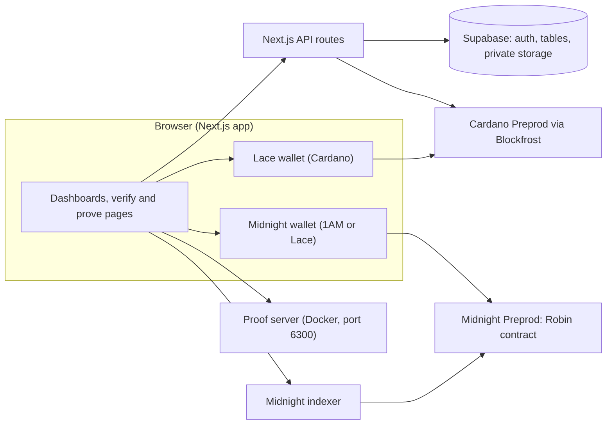
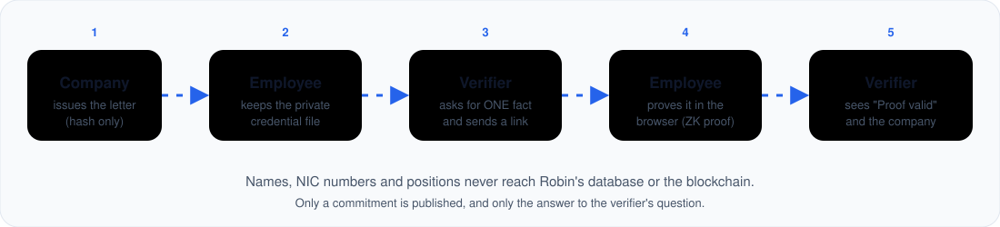
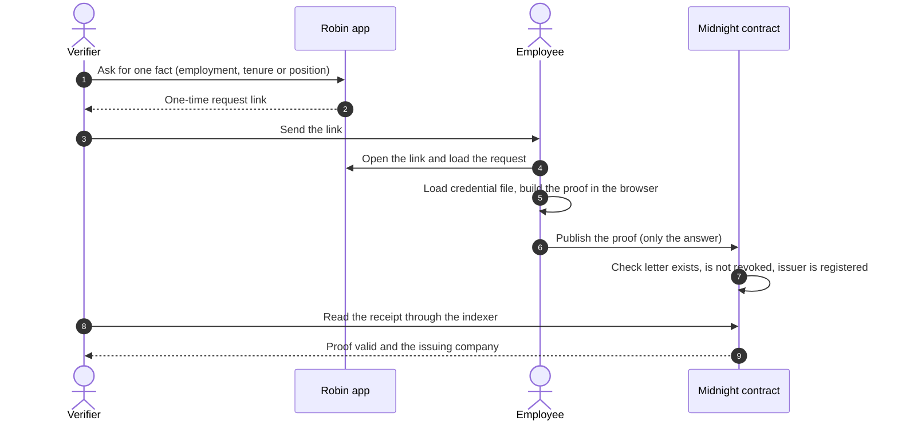
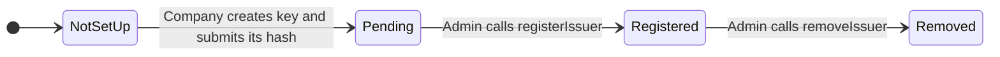
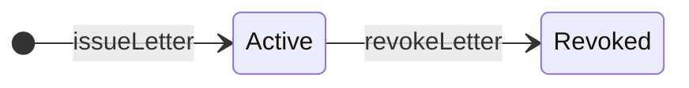

<p align="center">
  
</p>

<p align="center">
  
  
  
  
  
  
  
</p>

<p align="center">
  <b>Issue a letter once. Let anyone verify it in seconds. Let employees share only the facts that matter.</b>
</p>

Robin lets companies issue employment and service letters that anyone can check on the blockchain. It offers two ways to issue a letter:

- **Standard letters** lock the PDF's fingerprint on **Cardano**. Anyone can scan the QR code or upload the PDF to verify it.
- **Private letters** use **Midnight**. The employee keeps all the details and later proves a single fact (for example "worked here for at least 2 years") without showing the letter.

If a letter was edited, faked or revoked, Robin says so.

Built for **UniHack 2026** by Coin Ceylon.

> **Demo video:** _add link here_ &nbsp;|&nbsp; **Live demo:** _add link here_

## Contents

[The problem](#the-problem) ·
[The solution](#the-solution) ·
[Architecture](#architecture) ·
[How it works](#how-it-works) ·
[On-chain design](#on-chain-design) ·
[Features](#features) ·
[Getting started](#getting-started) ·
[Testing](#testing) ·
[Project structure](#project-structure) ·
[Known issues](#known-issues-and-limits) ·
[Roadmap](#roadmap)

---

## The problem

Fake experience letters are cheap to make and hard to catch. Many Sri Lankans applying for jobs and visas abroad are asked for service letters, and employers, agencies and embassies have no fast way to tell a real letter from a forged one. Checking today means phoning or emailing the company and waiting days, if anyone answers at all.

A second problem sits on the other side: to prove employment, workers must hand over a full letter with their NIC, salary and dates, even when the verifier needs only one fact.

## The solution

| | Standard letter (Cardano) | Private letter (Midnight) |
|---|---|---|
| What the company publishes | A SHA-256 hash of the PDF | A commitment that hides all employee data |
| What the verifier sees | The letter itself, plus Valid / Revoked / Tampered | Only the answer to one question, plus the issuing company |
| How it is verified | Scan the QR code or upload the PDF | The verifier sends a request link; the employee proves from a private credential file |
| Best for | Letters meant to be shown in full | Proving employment, tenure or position without sharing personal data |

Anyone can verify. Robin checks the blockchain, not just its own database, so a forged or edited letter cannot pass.

---

## Architecture



---

## Who it's for, and how it's sustained

| User | What they get |
|------|---------------|
| **Companies** (HR teams) | Issue and revoke official letters, in bulk from Excel, with their own formats, team access and optional private letters |
| **Employees** | A letter employers abroad can trust instantly, and a way to prove facts without exposing personal data |
| **Verifiers** (recruiters, agencies, embassies, universities) | Free, instant verification with no account needed |
| **Registrars** (HR consultancies, accountants, agents) | Register and manage many companies on their behalf |

**Sustainability.** Verification is free, so the network spreads. Registrars are the paying side: the Free plan allows up to 5 company submissions, and the Premium plan (planned at $10 per month) allows unlimited submissions. Companies on the Free plan can issue up to 5 letters in total (standard and private together); Premium is unlimited. Robin's team verifies every company before it gets the "Verified" badge.

**Where blockchain adds value**

- **Nobody can quietly alter a letter**, including Robin.
- **Verification re-reads the chain, not just Robin's database.**
- **Revocation is public and cannot be hidden.** Only the issuing company's key can revoke, and the contracts enforce this.
- **Privacy by design.** PDFs are hashed in the browser. For private letters, names, NIC numbers and positions never reach Robin's servers.

---

## How it works

### Standard letters (Cardano)

1. **A company registers.** It submits its business registration (BR/ROC) and connects its Lace wallet. A registrar can also submit a company on its behalf.
2. **Robin's team reviews** the documents and marks the company **Verified**, **Rejected** or **Under Review**.
3. **The company issues a letter.** It fills in a format, Robin generates the PDF with a QR code, the browser hashes it, and the company signs one Cardano transaction in Lace.
4. **Anyone verifies.** They open the QR link (`/verify/<letterId>`) or upload the PDF at `/verify`.
5. **The company can revoke** a letter at any time from the dashboard.

### Private letters (Midnight)

<p align="center">
  
</p>

1. **The company creates an issuer key** in **Dashboard > Private Letters**. The secret key stays in the browser and a backup file is downloaded. Robin stores only its hash (the issuer ID) and marks the company `pending`.
2. **A Robin admin registers the company** at `/admin/midnight/issuers`. This calls `registerIssuer` on the Midnight contract and sets the company to `registered`.
3. **The company issues a private letter.** The browser builds a commitment from the employee's hashed details and a random salt, and `issueLetter` publishes only the commitment. The company downloads a **credential file** for the employee. Robin stores only the public record (ID, commitment, transaction, optional internal reference).
4. **A verifier asks for one fact** at `/verify-private`: verified employment, minimum tenure of N days, or a specific position. They send the generated link (`/prove/<id>`) to the employee.
5. **The employee proves it.** They open the link, load their credential file, and the proof is built in their browser. Only the answer is published.
6. **The verifier sees the result** read straight from the Midnight indexer: the proof, the issuing company and whether Robin verified it. The contract rejects the proof if the letter was revoked or the issuer is not registered.
7. **The company can revoke** a private letter from the Private Letters page.

<details>
<summary><b>See the verification as a sequence diagram</b></summary>



</details>

---

## On-chain design

### Cardano (standard letters)

Each letter is registered by sending **2 ADA** (returned to the issuer on revocation) to the Robin validator, with an inline datum:

```
LetterDatum { letter_hash: ByteArray (SHA-256), issuer: VerificationKeyHash }
```

- **UTxO unspent** means the letter is active. **UTxO spent** means it was revoked.
- Only a transaction signed by the `issuer` key can spend it. The Aiken validator in [`contracts/validators/letter_registry.ak`](./contracts/validators/letter_registry.ak) enforces this, with tests for the issuer, a stranger, an unsigned transaction and a missing datum.

The hash is also written to transaction metadata under label `7283`:

```json
{ "7283": { "hash": "<64-char sha256 hex>", "v": 1 } }
```

Bulk issuing writes many letters in one transaction:

```json
{ "7283": { "hashes": ["<hash>", "<hash>"], "v": 2 } }
```

### Midnight (private letters)

The Compact contract is [`midnight/robin_private.compact`](./midnight/robin_private.compact).

**Public ledger:** `admin` (hash of Robin's admin secret), `issuers` (registered companies, as hashes), `letters` (commitment to issuer), `revoked` (revoked commitments) and `receipts` (verifier nonce to what was proven, never the data).

**Private (only the employee's device sees it):** name, NIC, position, dates and the salt.

| Circuit | Who calls it | Purpose |
|---------|--------------|---------|
| `registerIssuer` / `removeIssuer` | Robin admin | Add or remove a company as an issuer |
| `issueLetter` | Company | Publish a commitment for a new letter |
| `revokeLetter` | Company | Mark a commitment revoked |
| `proveVerifiedEmployment` | Employee | Prove a valid, unrevoked letter from a registered issuer exists |
| `proveMinTenure` | Employee | Prove the letter covers at least N days |
| `provePosition` | Employee | Prove the position matches a value the verifier supplied |

Each verifier request carries a one-time nonce, so a request can be answered only once.





### What the standard verifier checks

`POST /api/verify` runs these checks in order and returns the first failure:

| Step | Check | If it fails |
|------|-------|-------------|
| 1 | A letter record exists (by ID or hash) | `not_found` |
| 2 | An uploaded PDF's hash matches the issued letter | `tampered` |
| 3 | The Cardano transaction exists | `not_found` |
| 4 | The hash on-chain equals the stored hash | `tampered` |
| 5 | The transaction was paid by the wallet recorded when the letter was issued | `tampered` |
| 6 | The letter is locked at the Robin contract | `tampered` |
| 7 | The contract UTxO has not been spent (not revoked) | `revoked` |
| 8 | All checks passed | `valid` |

A `valid` result also shows whether Robin has **verified the issuing company**.

---

## Features

### Public
- Verify a standard letter by uploading a PDF or scanning its QR code
- **Private Verify** (`/verify-private`): request one fact from an employee and read the proof from Midnight, with no account needed
- Clear results with the issuing company's verification status

### Companies (dashboard)
- **Analytics**: employee history, standard letter overview, and a **Private letters (Midnight)** card with issued, active and revoked counts
- **Issue Service Letter**: single or bulk issue from an Excel template (ZIP of PDFs, one transaction)
- **Private Letters**: create and back up the issuer key, issue and revoke private letters, download employee credential files
- **Manage Formats**: letter templates with placeholders such as `{{employee_name}}`, `{{nic}}`, `{{position}}`, `{{start_date}}`
- **Revoke Service Letter**: revoke a standard letter by ID or verification link
- **Assign Team**: add team members by Gmail; they can issue letters but cannot open Settings or create the private issuer key
- **Account Verification**, **Subscription & Plan**, and **Account Settings** (primary account only)
- **Generate with Robin AI**: AI-assisted letter writing

### Registrars
- Google sign-in
- Submit companies with an authorization letter, the company's Gmail and its BR
- Profile verification with NIC (individuals) or BR (businesses)
- Free plan limit of 5 submissions; Premium for unlimited

### Robin admins
- Review company applications and registrar verification (`/manage-applications`)
- **Midnight issuers** (`/admin/midnight/issuers`): see every company that enrolled a private key and register each on the contract with one click
- Admin access is limited to emails listed in `ADMIN_EMAILS`
- Status changes are enforced on the server, so two admins cannot overwrite each other

### Accounts
One Google account has exactly one role: admin, company, or registrar. Each role has its own portal.

---

## Document privacy

Business registration (BR/ROC), NIC and authorization documents are personal and business data, so they are never public.

- All documents live in one **private** Supabase bucket. There are no public links.
- Uploads go through `POST /api/documents/upload`. It limits files to 4 MB, accepts only PDF, PNG and JPG, and checks the file's real contents rather than its name. Anonymous uploads are rate limited.
- Admins see documents through **signed links** that expire after 1 hour. A registrar can only open their own documents, through links that expire after 2 minutes (`POST /api/documents/sign`).
- The database stores a storage path, not a URL.

For private letters, Robin's database stores no personal data: only the issuer hash, and for each letter an ID, a commitment, a transaction reference and an optional short internal note.

---

## Tech stack

| Layer | Technology |
|-------|------------|
| Framework | Next.js 16 (App Router, Cache Components), React 19, TypeScript |
| UI | Tailwind CSS 4, shadcn/ui |
| Database, auth, storage | Supabase (Google sign-in) |
| Standard letters | Cardano (Preprod), Aiken (Plutus v3), Lace (CIP-30), MeshJS, Blockfrost |
| Private letters | Midnight (Preprod), Compact, Midnight.js SDK, a Midnight wallet (1AM or Lace), a local proof server (Docker) |
| PDFs and QR codes | pdf-lib, qrcode |
| Bulk import | xlsx, jszip |
| Payments (sandbox) | PayHere |
| AI | Gemini or OpenRouter |

---

## Getting started

### Prerequisites

- Node.js 20 or newer
- A [Supabase](https://supabase.com) project with the Google auth provider enabled
- A [Blockfrost](https://blockfrost.io) project on the **Preprod** network (Cardano)
- The [Lace](https://www.lace.io) wallet on Preprod with test ADA, for standard letters
- [Aiken](https://aiken-lang.org) v1.1.24 (only if you change the Cardano contract)

For private letters you also need:

- A **Midnight Preprod** wallet with test funds for fees (DUST). The app works with any wallet on `window.midnight`; 1AM and Lace are tested. If Lace's websocket fails, use 1AM.
- **Docker**, to run the Midnight proof server
- The **Compact compiler** (only if you change the Midnight contract)
- A Midnight Preprod Blockfrost project ID

### Install and run

```bash
git clone https://github.com/Areca-Fountain/robin.git
cd robin
npm install
cp .env.example .env.local   # then fill in the values below
npm run dev
```

Open <http://localhost:3000>.

### Environment variables

| Variable | Scope | Description |
|----------|-------|-------------|
| `NEXT_PUBLIC_SUPABASE_URL` | Public | Supabase project URL |
| `NEXT_PUBLIC_SUPABASE_ANON_KEY` | Public | Supabase anon key (browser) |
| `SUPABASE_SERVICE_ROLE_KEY` | **Server only** | Supabase service-role key |
| `NEXT_PUBLIC_BLOCKFROST_KEY` | Public | Cardano Preprod key used by the browser to build transactions |
| `BLOCKFROST_KEY` | **Server only** | Cardano Preprod key for server-side chain reads |
| `BLOCKFROST_URL` | Server only | Optional. Defaults to `https://cardano-preprod.blockfrost.io/api/v0` |
| `ADMIN_EMAILS` | **Server only** | Comma-separated emails of Robin admins |
| `NEXT_PUBLIC_APP_URL` | Public | The site's URL (`http://localhost:3000` locally) |
| `PAYHERE_MERCHANT_ID`, `PAYHERE_MERCHANT_SECRET`, `PAYHERE_MODE` | Server only | PayHere payments; keep `PAYHERE_MODE=sandbox` while testing |
| `AI_PROVIDER` | Server only | `gemini` or `openrouter`. Set it once, then add the matching key below |
| `GEMINI_API_KEY`, `GEMINI_MODEL` | Server only | Used when `AI_PROVIDER=gemini` |
| `OPENROUTER_API_KEY`, `OPENROUTER_MODEL` | Server only | Used when `AI_PROVIDER=openrouter` |
| `NEXT_PUBLIC_MIDNIGHT_ENABLED` | Public | `true` to turn the private-letters feature on |
| `NEXT_PUBLIC_MIDNIGHT_NETWORK_ID` | Public | `preprod` |
| `NEXT_PUBLIC_MIDNIGHT_BLOCKFROST_KEY` | Public | Midnight Preprod project ID (visible in the browser; use a Preprod project only) |
| `NEXT_PUBLIC_MIDNIGHT_PROVER_URI` | Public | Proof server URL, `http://localhost:6300` locally |
| `NEXT_PUBLIC_MIDNIGHT_CONTRACT_ADDRESS` | Public | The deployed contract address, on one line with no spaces or quotes |

Optional overrides: `NEXT_PUBLIC_MIDNIGHT_INDEXER_URI`, `NEXT_PUBLIC_MIDNIGHT_INDEXER_WS_URI` and `NEXT_PUBLIC_MIDNIGHT_NODE_URI`.

Never commit `.env.local`, and never expose the service-role key to client code. Variables that start with `NEXT_PUBLIC_` are visible in the browser, and changing them needs a rebuild.

### Supabase setup

- **Tables:** `company_applications`, `company_members`, `registrar_profiles`, `letters`, `letter_formats`
- **Storage bucket:** one **private** bucket, `company-documents` (4 MB limit; PDF, PNG and JPG only)
- **Auth:** Google provider enabled; add your app URL to the allowed redirect URLs
- **Private letters tables:** run the SQL files in [`supabase/`](./supabase) in order, in the Supabase SQL editor:
  1. `001_mn_tables.sql` creates `mn_issuers`, `mn_letters` and `mn_verify_requests`
  2. `002_mn_letters_note.sql` adds the optional internal reference to `mn_letters`

The `letters` table needs at least: `id` (uuid), `company_id`, `company_name`, `employee_name`, `position`, `issued_at`, `letter_hash`, `tx_hash`, `issuer_address`, `revoked`.

### Cardano smart contract

The compiled contract (`contracts/plutus.json`) is committed, so you only need Aiken if you change the validator.

```bash
cd contracts
aiken check    # run the validator tests
aiken build    # regenerates plutus.json
```

### Midnight setup (private letters)

**1. Compile the contract** (skip if you already have the compiled files):

```bash
cd midnight
npm run compile
```

This writes `midnight/managed/robin_private`. Copy that folder to `public/midnight/managed/` so the browser can load the ZK keys. Both folders are ignored by Git today, so a deployment must include them (commit them, or compile during the build).

**2. Start the proof server** and keep it running:

```bash
docker run -p 6300:6300 midnightntwrk/proof-server:latest -- midnight-proof-server -v
```

Use the image tag recommended in the Midnight docs for your SDK version.

**3. Deploy the contract once** from the admin deploy page (`/admin/midnight`), signed in as an admin with a Midnight wallet on Preprod. The page shows a **Download admin secret** button. Save `robin-midnight-admin-secret.json`: it is the only thing that can register issuers, and it is stored nowhere else. Put the printed contract address in `NEXT_PUBLIC_MIDNIGHT_CONTRACT_ADDRESS`.

**4. Rules to remember**

> [!IMPORTANT]
> Keys and credential files are secrets. Never commit them, and keep the admin secret file somewhere safe: it cannot be recovered.

- The address belongs to one compiled contract. If you change `robin_private.compact`, you must recompile, redeploy, update the address, and copy the new `managed` folder to `public/midnight/managed/`.
- Use the same wallet and the same browser for a full test cycle. The browser stores private state per wallet and per domain.
- Keys and credential files are secrets. Never commit them: `robin-*secret*.json`, `robin-*issuer*.json` and `robin-credential-*.json` belong in `.gitignore`.

### Scripts

| Command | Description |
|---------|-------------|
| `npm run dev` | Start the dev server |
| `npm run build` | Production build (also type-checks) |
| `npm start` | Run the production build |
| `npm run lint` | Lint with ESLint |

---

## Testing

[`QA-CHECKLIST-private-letters.md`](./QA-CHECKLIST-private-letters.md) lists the test cases for the private-letter flow by role: company dashboard, admin, issue/prove/verify/revoke, access control, privacy and regression checks.

A quick smoke test of the full cycle:

1. Company: **Private Letters > Create issuer key > Submit to Robin**
2. Admin: `/admin/midnight/issuers` > load the admin secret > **Register on Midnight**
3. Company: issue a private letter and download the credential file
4. Verifier: `/verify-private` > create a request and copy the link
5. Employee: open the link > load the credential > **Prove and publish**
6. Verifier: the page shows **Proof valid** and the issuing company
7. Company: revoke the letter, create a new request, and confirm the proof is now refused

---

## Project structure

```
app/
  page.tsx                  Landing page
  login/                    Company login
  verify/                   Public verification (upload + QR landing)
  verify-private/           Verifier page for private letters
  prove/[id]/               Employee page: prove a claim from a credential file
  register-company/         Company registration with Lace wallet
  registrar/                Registrar portal
  manage-applications/      Admin portal
  admin/midnight/           Contract deploy page; issuers/ registers companies
  dashboard/                Company dashboard
    issue/  formats/  revoke/  team/  settings/  verification/
    subscription/  ai/  private/ (private letters)
  api/                      Server routes
    verify/  issue/  formats/  team/  letters/utxo/
    company/wallet/  documents/(upload, sign)  dashboard/me/  auth/  admin/
    midnight/  issuers  issuers-info  letters  verify-requests
    payhere/  ai/
components/
  auth/                     Role gate and account hook
  dashboard/                Bulk issue, wallet setup, company provider,
                            PrivateLettersCard (analytics, issue, settings, revoke)
  layout/                   Navbar
  providers/                MeshJS wallet provider
  ui/                       shadcn/ui components
  VerifyResult.tsx          Result card
lib/
  letter-tx.ts  letter-pdf.ts  letter-format.ts  hash.ts  contract.ts
  cardano.ts  letter-chain.ts  auth-server.ts  wallet-key.ts
  supabase.ts  supabase-admin.ts  documents-server.ts  documents-client.ts
  wallet-status.ts
  midnight/
    config.ts               Network URIs and the contract address
    lace-connector.ts       Finds and connects the Midnight wallet
    providers.ts            Builds the SDK providers and submits transactions
    contract-api.ts         registerIssuer, issueLetter, revokeLetter, prove calls
    credential.ts           Hashing, commitments and the credential file format
    company-issuer.ts       Creating and storing the company issuer key
    chain-read.ts           Reads proofs from the indexer (verifier side)
contracts/
  validators/letter_registry.ak   Cardano registry and revocation
  plutus.json                     Compiled Cardano contract
midnight/
  robin_private.compact     Midnight contract
  witnesses.ts              Private inputs for the circuits
  managed/                  Compiled output (generated)
supabase/
  001_mn_tables.sql  002_mn_letters_note.sql
docs/
  banner.svg  private-flow.svg   README artwork (animated)
```

---

## Known issues and limits

- Everything runs on the **Cardano Preprod** and **Midnight Preprod** testnets. No real funds are involved.
- **Linkability (Midnight MVP).** A proof publishes the letter's commitment (never its content), so someone could link that proof to the issuing transaction. A Merkle-tree version would remove this link and is planned as an upgrade.
- **The proof server sees private inputs** while it builds a proof, including secrets. Run it locally for real use.

> [!WARNING]
> A shared, Robin-hosted proof server lets its operator see that data. That is acceptable only for a demo.

- **Browser storage is per wallet and per domain.** The company issuer key created on one domain does not exist on another; import the backup file instead. Losing the backup means the company can no longer issue or revoke private letters.
- Each verifier link works once, because the contract rejects a second answer to the same nonce.
- Some registrar and company-registration writes (profile, plan, application status) still go from the browser straight to Supabase, so they depend on your Row Level Security rules. Moving them to server routes is planned.
- Premium is a plan switch only in the app. PayHere runs in sandbox mode.
- Anonymous upload rate limiting is in memory, so it resets on serverless hosting.
- The older `company-docs` bucket is only read for legacy rows. Keep it private too.

---

## Roadmap

- Merkle-tree credentials on Midnight, to remove the proof-to-issuance link
- Wallet-side proving, so no proof server needs to see private data
- Real payment handling for the Registrar Premium plan
- Verification API keys for agencies and embassies
- Mainnet deployment after audit

---

## License

Apache License 2.0. See [LICENSE](./LICENSE).